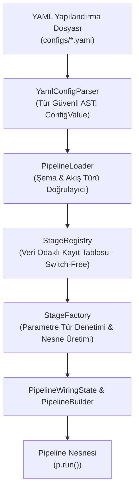

# LogFlow Mimarisi — Artım 4: Yapılandırma Odaklı Birleştirme ve Aşama Kaydı

## 1. Artım 4 Mimari Odak ve Hedefler

LogFlow projesinin 4. Artımı, mimari odak noktasını **genişletilebilirlik (extensibility)**, **eklenti/kayıt defteri (plugin/registry) tasarım kalıbı** ve **mimari tanımının (architecture definition) mimari gerçekleştiriminden (architecture implementation) ayrılması** ilkeleri üzerine kurmaktadır.

### Temel Kilometre Taşı (Core Milestone)
> **Yeni bir işlem hattı (pipeline) oluşturmak için kodun yeniden derlenmesi (recompilation) gerekmemelidir.**

Bu hedefe ulaşmak için:
1. İşlem hattının topolojisi (hangi kaynağın, hangi aşamaların, hangi sırayla ve parametrelerle hangi hedefe bağlanacağı) C++ kaynak kodundan çıkarılıp **bildirimsel (declarative) YAML yapılandırma dosyalarına** taşınmıştır.
2. Sabit kodlanmış `switch` veya `if-else` yapılarına dayanmayan, tamamen **veri odaklı (data-driven)** bir `StageRegistry` ve `StageFactory` mekanizması kurulmuştur.
3. Yapılandırmayı okuyan, her aşamanın karşılık gelen gerçekleştirimini bulan, parametreleri çalışma öncesinde tür denetimine tabi tutarak doğrulayan (**Fail Fast, Fail Loudly**) ve bir `Pipeline` nesnesi üreten `PipelineLoader` geliştirilmiştir.

---

## 2. Bildirimsel Yapılandırma Şeması (Configuration Schema)

LogFlow boru hatları, okunabilirliği yüksek bir YAML şeması ile tanımlanır. Bir yapılandırma dosyası en üst düzeyde `pipeline` kök nesnesini içerir:

```yaml
pipeline:
  name: <string>                  # İşlem hattının mantıksal adı (ör. error-report)

  source:                         # Veri kaynağı tanımı (Zorunlu)
    type: <string>                # Kayıtlı kaynak türü adı (ör. file)
    params: { <anahtar>: <deger> } # Kaynağa özgü doğrulanmış parametreler

  stages:                         # Sıralı aşama listesi (Zorunlu, en az 1 aşama)
    - type: <string>              # Kayıtlı aşama türü adı (ör. parse, filter, project)
      params: { ... }             # Aşamaya özgü doğrulanmış parametreler

  sink:                           # Çıktı hedefi tanımı (Zorunlu)
    type: <string>                # Kayıtlı hedef türü adı (ör. file, console)
    params: { <anahtar>: <deger> } # Hedefe özgü doğrulanmış parametreler
```

### 2.1. Kayıtlı Bileşen Türleri ve Parametre Şeması Tablosu

| Bileşen Kategorisi | `type` Adı | Gerçekleştirim Sınıfı | Akış Türü (`In -> Out`) | Zorunlu Parametreler ve Türleri | Açıklama ve Geçerli Değerler |
| :--- | :--- | :--- | :--- | :--- | :--- |
| **Source (Kaynak)** | `file` | [`FileLineSource`](file:///home/yunus/Desktop/yazılım_mimarisi/ym_logflowPipeline/FileLineSource.hpp) | `void -> string` | `path: string` | Okunacak log dosyasının yolu (ör. `data/access.log`). |
| **Stage (Aşama)** | `parse` | [`ParserStage`](file:///home/yunus/Desktop/yazılım_mimarisi/ym_logflowPipeline/ParserStage.hpp) | `string -> LogRecord` | `format: string` | Ayrıştırma biçimi. Geçerli değerler: `clf`, `combined`. |
| **Stage (Aşama)** | `filter` | [`PredicateFilterStage`](file:///home/yunus/Desktop/yazılım_mimarisi/ym_logflowPipeline/PredicateFilterStage.hpp) | `LogRecord -> LogRecord` | `field: string`<br>`op: string`<br>`value: int \| string` | Sayısal alanlar (`status`, `bytes`) için `value` **integer**, metin alanları (`clientIp`, `method`, `path`, `userAgent`, `timestamp`) için `value` **string** olmalıdır. |
| **Stage (Aşama)** | `project` | [`ProjectionStage`](file:///home/yunus/Desktop/yazılım_mimarisi/ym_logflowPipeline/ProjectionStage.hpp) | `LogRecord -> LogRecord` | `fields: list<string>` | Çıktıya aktarılacak alan adları dizisi (ör. `[timestamp, clientIp, status, path]`). |
| **Sink (Hedef)** | `file` | [`FileSink`](file:///home/yunus/Desktop/yazılım_mimarisi/ym_logflowPipeline/FileSink.hpp) | `LogRecord -> void` | `path: string` | Çıktının yazılacağı dosya yolu (ör. `out/errors.txt`). |
| **Sink (Hedef)** | `console` | [`ConsoleSink`](file:///home/yunus/Desktop/yazılım_mimarisi/ym_logflowPipeline/ConsoleSink.hpp) | `LogRecord -> void` | *(Yok)* | Biçimlendirilmiş kayıtları standart çıktıya (`stdout`) yazar. |

### 2.2. `filter` Aşaması Alan ve Operatör Tür Kuralları

| Alan (`field`) | Beklenen `value` Türü | Desteklenen Operatörler (`op`) | Örnek Yapılandırma |
| :--- | :--- | :--- | :--- |
| `status` | `integer` (Tamsayı) | `==`, `!=`, `>`, `>=`, `<`, `<=` | `{ field: status, op: ">=", value: 400 }` |
| `bytes` | `integer` (Tamsayı) | `==`, `!=`, `>`, `>=`, `<`, `<=` | `{ field: bytes, op: ">=", value: 1024 }` |
| `path` | `string` (Metin) | `==`, `!=`, `startsWith`, `contains`, `endsWith`, `>`, `>=`, `<`, `<=` | `{ field: path, op: "startsWith", value: "/api" }` |
| `clientIp` / `ip` | `string` (Metin) | `==`, `!=`, `startsWith`, `contains`, `endsWith` | `{ field: clientIp, op: "==", value: "192.168.1.15" }` |
| `method` | `string` (Metin) | `==`, `!=`, `startsWith`, `contains`, `endsWith` | `{ field: method, op: "==", value: "POST" }` |
| `userAgent` | `string` (Metin) | `==`, `!=`, `startsWith`, `contains`, `endsWith` | `{ field: userAgent, op: "contains", value: "Mozilla" }` |
| `timestamp` | `string` (ISO-8601) | `==`, `!=`, `>`, `>=`, `<`, `<=`, `startsWith` | `{ field: timestamp, op: ">=", value: "2026-09-29T07:01:00Z" }` |

---

## 3. Eklenti / Kayıt Defteri Mimarisi (`StageFactory`, `StageRegistry`, `PipelineLoader`)



### 3.1. `StageFactory` ([`StageFactory.hpp`](file:///home/yunus/Desktop/yazılım_mimarisi/ym_logflowPipeline/StageFactory.hpp))
- Her aşama fabrikası, girdi akış türünü (`string` veya `LogRecord`), çıktı akış türünü (`LogRecord`) ve parametre doğrulayıcı kurucu fonksiyonu sarmalar.
- `StageParams` sınıfı üzerinden `requireString()`, `requireInt()`, `requireStringList()` ve `rejectUnknownParams()` metotlarıyla sıkı tür denetimi uygular.

### 3.2. `StageRegistry` ([`StageRegistry.hpp`](file:///home/yunus/Desktop/yazılım_mimarisi/ym_logflowPipeline/StageRegistry.hpp)) — Veri Odaklı ve `switch` İçermeyen Kayıt Sistemi
- Kayıt işlemi hiçbir şekilde sabit kodlanmış `switch` veya `if-else` zincirine dayanmaz.
- Aşama türü adlarını (`"parse"`, `"filter"`, `"project"`) doğrudan `std::map<std::string, StageFactory>` tablosunda tutar.
- **Açık-Kapalı İlkesi (OCP):** Sisteme yeni bir aşama eklemek için `PipelineLoader` veya mevcut aşamalar değiştirilmez; `StageRegistry::instance().registerStage("yeni_asama", ...)` çağrısı veya `REGISTER_LOGFLOW_STAGE("yeni_asama", fabrikaFn)` bildirimsel makrosu ile kayıt tablosuna yeni bir satır eklenmesi yeterlidir.

### 3.3. `PipelineLoader` ([`PipelineLoader.hpp`](file:///home/yunus/Desktop/yazılım_mimarisi/ym_logflowPipeline/PipelineLoader.hpp))
- YAML yapılandırmasını okur, topolojiyi (`source -> stages -> sink`) doğrular, `StageRegistry` üzerinden ilgili fabrikaları çağırır ve çalıştırılmaya hazır bir `Pipeline` nesnesi döndürür.
- `PipelineWiringState` aracılığıyla aşamalar arası akış uyumluluğunu denetler (örneğin `parse` aşamasından önce `filter` konulursa yapılandırma zamanında hata verir).

---

## 4. Yapılandırma Zamanı Hataları vs. Çalışma Zamanı Veri Hataları

Ödevin 3. görevinde vurgulanan en önemli mimari ayrım şudur:

| Özellik | Yapılandırma Zamanı Hataları (Configuration-Time Errors) | Çalışma Zamanı Veri Hataları (Runtime Data Errors) |
| :--- | :--- | :--- |
| **Ne Zaman Oluşur?** | Boru hattı inşa edilirken (`PipelineLoader::load`), **henüz hiçbir log satırı okunmadan veya işlenmeden önce**. | Boru hattı başarıyla kurulup `pipeline.run()` ile veri akışı başladıktan sonra, bozuk bir veri satırıyla karşılaşıldığında. |
| **Örnek Durumlar** | - Bilinmeyen aşama türü (`type: geoip`)<br>- Eksik zorunlu parametre (`value` unutulmuş)<br>- Yanlış parametre türü (`status` için `"abc"` metni verilmiş)<br>- Boş işlem hattı (`stages: []`)<br>- Akış türü uyumsuzluğu (`parse` öncesi `filter`) | - Bozuk CLF log satırı (`MALFORMED_LINE`)<br>- Geçersiz HTTP durum kodu (`999` veya `BAD_STATUS`)<br>- Bozuk tarih damgası (`[invalid-date]`) |
| **Mimari Tepki Stratejisi** | **Fail Fast, Fail Loudly (Hızlı ve Açık Başarısızlık):** Sistem derhal durmalı, hiçbir kısmi çıktı üretmemeli ve kullanıcıya hatanın yerini/çözümünü gösteren açık bir `ConfigValidationException` mesajı üretmelidir. | **Resilience / Hataya Dayanıklılık (5. Haftanın Konusu):** Tek bir bozuk log satırı tüm boru hattını çökertmemelidir; hatalı kayıt sayılmalı, atlanmalı veya ölü mektup kuyruğuna (Dead-Letter / Error Channel) yönlendirilmelidir. |

---

## 5. Üç Farklı Yapılandırma Dosyası ve Davranış Karşılaştırması

Değiştirilmemiş aynı `./logflow` çalıştırılabilir dosyası, yeniden derlenmeksizin üç farklı yapılandırma dosyasıyla üç farklı veri işleme boru hattı kurar:

1. **Hata Raporu ([`configs/error-report.yaml`](file:///home/yunus/Desktop/yazılım_mimarisi/ym_logflowPipeline/configs/error-report.yaml)):**
   - **Davranış:** `status >= 400` olan HTTP hata kayıtlarını süzer ve `[timestamp, clientIp, status, path]` alanlarını `out/errors.txt` dosyasına yazar.
2. **API Trafiği Veri Çıkarımı ([`configs/api-traffic.yaml`](file:///home/yunus/Desktop/yazılım_mimarisi/ym_logflowPipeline/configs/api-traffic.yaml)):**
   - **Davranış:** `path` alanı `"/api"` ile başlayan tüm API isteklerini süzer ve `[timestamp, method, path, status, bytes]` alanlarını `out/api-traffic.txt` dosyasına yazar.
3. **İstemci Bazında Bant Genişliği Veri Çıkarımı ([`configs/bandwidth-by-client.yaml`](file:///home/yunus/Desktop/yazılım_mimarisi/ym_logflowPipeline/configs/bandwidth-by-client.yaml)):**
   - **Davranış:** `bytes >= 1024` olan yüksek bant genişlikli yanıtları süzer ve istemci bazlı analiz için `[clientIp, bytes, path, status]` alanlarını `out/bandwidth-by-client.txt` dosyasına yazar.

---

## 6. Artım 3 Mirası: Sıralama Deneyi ve Bileşilebilirlik Analizi (Ordering Experiment)

*(Artım 3 kapsamında yürütülen 25.000 satırlık bileşilebilirlik ve sıralama deneyinin özeti aşağıda korunmuştur.)*

- **Soru 1: Ayrıştırmadan (`parse`) önce filtrelemek neden mümkün değildir?**
  Ham metin (`std::string`) henüz tipli alan modeline (`LogRecord`) dönüştürülmemiştir. Artım 4'te `PipelineWiringState`, `parse` öncesinde `filter` veya `project` tanımlanmasını yapılandırma zamanında yakalayarak engeller.
- **Soru 2: Projeksiyondan önce mi sonra mı filtrelemek gerekir?**
  - **Sıra A (Filter-First):** `parse -> filter -> project -> sink`
  - **Sıra B (Project-First):** `parse -> project -> filter -> sink`
  - **Deneysel Sonuç:** 25.000 satırlık veri kümesinde her iki sıra da **birebir aynı 247.389 baytlık çıktıyı (SHA-256: `08562754...19a321f`)** üretmiştir. Ancak Sıra A, elenen 20.147 kayıt için gereksiz projeksiyon kopyalamasını önleyerek bellek verimliliğinde üstünlük sağlamıştır.
